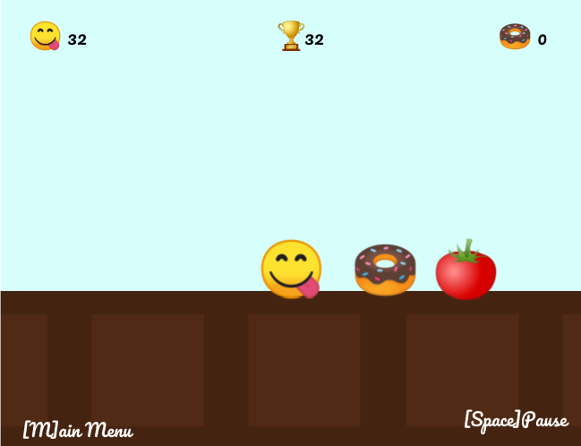

# Sweet Word - P5.js Game

This project was created in 2019 for the Game Development Unit in at Ada College.
The task was the create a game that incorporates emojis and uses the library P5.js.
As a result, Sweet World was born.

This game is currently hosted on GitHub pages, so feel free to check it out and have a play.

> Please Note: This project is no longer maintained.